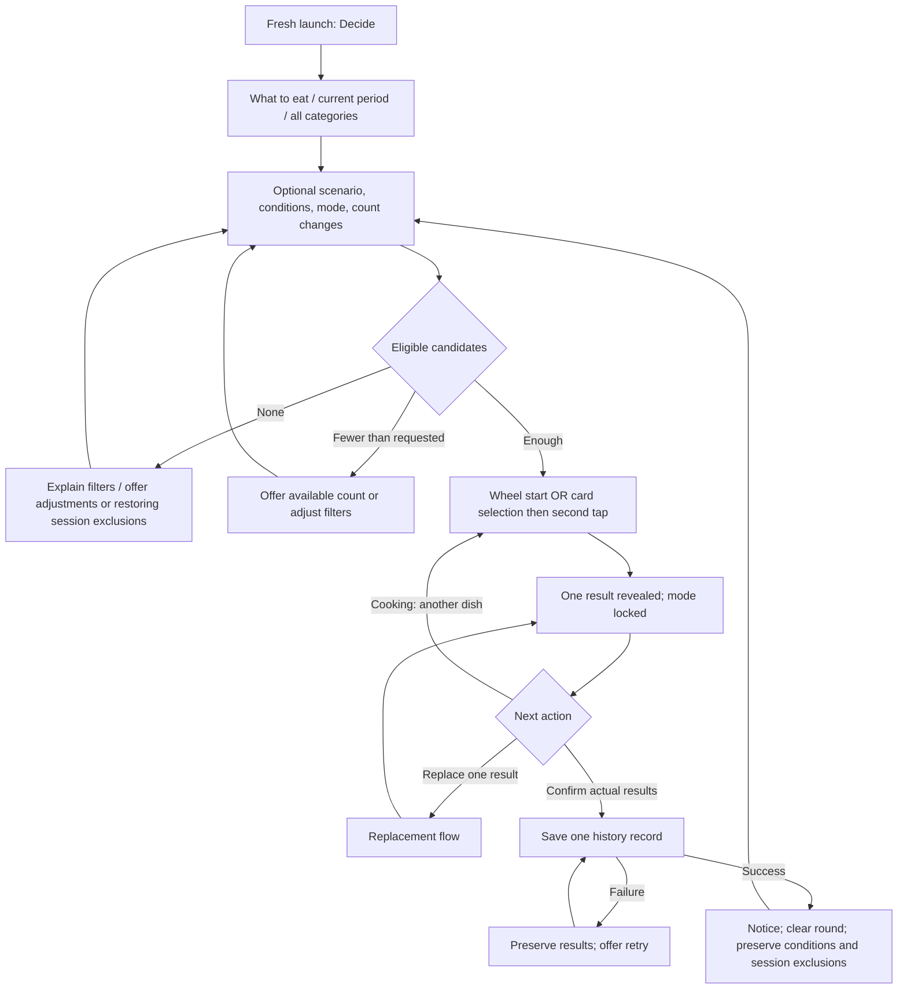

# Meal app: product structure, page flows, and technical direction

Updated: 2026-10-09, Asia/Shanghai.

## Status and authority

Cards design continuation: the user approved the target-based interaction, visual/motion direction, and first-use guidance on 2026-10-09, and authorized S08 implementation in the next session. This session records decisions only. [S08 / Issue #9](https://github.com/xinlx227-ai/Whatever/issues/9) owns single-target Cards across all scenarios and single-result replacement; [S09 / Issue #10](https://github.com/xinlx227-ai/Whatever/issues/10) owns multi-target collection; [S10 / Issue #11](https://github.com/xinlx227-ai/Whatever/issues/11) owns multi-target slot replacement. Approval is not implementation or native validation evidence.

Implementation continuation: S01 began on 2026-10-06 under [Issue #2](https://github.com/xinlx227-ai/Whatever/issues/2). Current build/test evidence lives in [S01 verification](../verification/s01-android.md); the proposed technical sections below retain their historical planning role.

This is supporting planning context. The [product specification and vertical-slice map](https://github.com/xinlx227-ai/Whatever/issues/1) and its child issues are the formal scope, acceptance criteria, and dependency tracker. The [planning handoff](meal-app-handoff.md) preserves historical accepted behavior and superseded proposals. The user authorized issue publication and repository commit/push on 2026-10-05; this task does not start app implementation or adopt unresolved technical choices.

Sections marked **accepted** summarize existing decisions. Sections marked **proposed** are recommendations for review or technical validation. The Oct 9 single-target confirmation labels below are accepted; other Chinese strings remain working copy. Keep technical recommendations separate from accepted product behavior. Earlier content/framework readiness notes are historical; use the formal issues and delivered verification reports for current status.

## Product shape — accepted

The app helps people complete an everyday meal decision through an enjoyable draw. Android v1 contains three independent scenarios: What to eat (吃什么), What to cook (做什么), and Where to eat (去哪吃). Each offers Wheel (转盘) and Cards (抽卡), an editable local option library, and confirmed-choice history. Cooking supports 1–10 distinct dishes; the other scenarios produce one result.

Users can draw immediately using defaults. No account, synchronization, connected group room, nearby discovery, recipe generation, dietary filtering, or recommendation weighting is part of the accepted release. Online name recognition supplements local entry assistance; it is not a dependency of drawing or history.

### Content readiness

| Inventory | Accepted | Remaining work |
| --- | --- | --- |
| What to eat | Nine named food-type categories, Unclassified fallback, separate drinks, corrections to examples, and the documented meal-period assignments | Reconcile the previously proposed 32-option list into one reviewable inventory. The complete list has not received blanket approval. Accepted individual corrections and assignments remain accepted. |
| What to cook | 26 dishes and their documented periods; the listed primary/additional category memberships | Curate any additional system-maintained memberships without presenting them as already approved |
| Where to eat | 12 brands, dining types, and periods in the handoff | Prepare stable content identifiers and default illustrations; brand inclusion makes no availability claim |

Keep the actual item inventories in the handoff until formalization. Present the unresolved What to eat inventory once as a whole, rather than reopening accepted items one by one.

## Page structure — accepted destinations, proposed organization

Bottom navigation remains Option library (选项库), Decide (决定), History (足迹); launch into Decide. The exact nested-page versus sheet presentation below is proposed. It adds no bottom-navigation destination.

| Surface | Content and primary action | Return behavior |
| --- | --- | --- |
| Decide | Scenario, period, multi-category filters, yesterday filter, mode; cooking-only count; draw surface, results, confirmation | Preserve the round across tab browsing |
| Option library | Scenario selector, name/alias search, active/deactivated/all filter, options, create entry, category management; Settings at top right | Browsing preserves the round; an actual saved library change invalidates it |
| Option create/edit | Name, image preview and image selection, category, periods; restaurant address and notes when relevant | Prompt before discarding unsaved edits; saved changes return to the library |
| Category management | Scenario-scoped categories; rename, create, custom-category deletion confirmation | Custom-category deletion preserves options in Unclassified |
| Settings | Online recognition toggle and consent explanation when needed | Return to library |
| History | Date-grouped records, newest first, scenario filters | Viewing preserves the round |
| History detail | Complete contents of one confirmation; delete whole record after confirmation | Completed deletion invalidates the unfinished round |

Built-in food/dish edit forms allow display edits and show categories/periods read-only. User-created food/dish forms allow one category and multiple periods. Restaurant period editing follows the accepted rule, including built-in restaurants. Category renaming retains its underlying identity.

### Decide layout

Keep the same positions for scenario, period, filters, mode, and bottom navigation in both visual themes. Put the cooking count below category filters and above the draw surface. Names remain fully readable in the result area even if wheel labels are omitted for a large pool.

- Wheel: bright playful atmosphere, explicit start control, current progress, and results with replacement access.
- Cards: preserve the exact canonical [black-purple-gold card back](../design/assets/card-back-celestial-black-purple-gold.png), with a horizontally browsable overlapping fan above the central reveal/detail area. The face uses dark purple, a fine gold border, light name text, and a warm light illustration region; show the complete name and illustration without a category label.
- Single-target Cards: the revealed result remains central with direct confirmation and Replace (换一个), without collection interaction or a bottom result row. Use “就吃这个,” “就做这 1 道菜,” or “就去这家” for confirmation.
- Multi-target Cards: tapping the central revealed card collects it into one horizontally scrolling row of small result cards; tapping a small card reopens that result. This branch remains active even with only one revealed result or early confirmation. Collecting/reopening is presentation, not persistence or another draw.
- Confirmation: one action based on actual revealed results, available before reaching the requested cooking count. An uncollected but revealed central card is already a result. Choose the single/multi interaction by the round's target/requested count, never by revealed count or implementation phase.

Accepted layout and motion direction: allow vertical page scrolling on small screens while preserving the large card, readable full name, and usable touch areas; keep confirmation above bottom navigation. Horizontal fan scrolling only browses and preserves selected-card identity even off-screen; it does not reveal, cancel, or reshuffle. Selection takes approximately 0.2 seconds, reveal movement/enlargement/flip 0.7–0.9 seconds, and multi-target collection 0.3 seconds. Use light haptic feedback, no sound, and reduced motion that preserves the manual steps. Validate enlarged Chinese text, safe areas, tap/scroll separation, and pending-replacement feedback on-device.

S08 retains current food drawings and fills missing generic plate/storefront and dining-type shop illustrations; the user delegated their design to the implementation agent. User-selected images take priority, with stable automatic defaults when none are selected. The [handoff's card-face rules](meal-app-handoff.md#card-face-content) retain the image-selection behavior and fallback assignments.

## Main flows

### Launch and draw — accepted

First installation starts in Wheel; later launches restore the last mode and yesterday-filter selection. Fresh launch resets cooking count to one and clears session exclusions and unfinished results. Returning to an app that remains running preserves its current state.

In Cards, first tap selects and second tap reveals. For target one, keep the revealed card central for confirmation or replacement. For target above one, tapping the revealed card collects it and tapping a collected card reopens that same result; neither consumes another slot. In Wheel, every result requires a separate start press.

First-use Cards guidance accompanies real actions rather than a separate demo: browse/select, second tap to reveal, then confirm or replace in a single-target round. Offer Skip. Completing or skipping suppresses future automatic tutorial runs; afterward use brief contextual hints. The single-target tutorial teaches no collection step.

### Replacement — accepted

1. Open Replace (换一个) for one existing result. In Cards, this action is beside the central card.
2. Choose Redraw (重新抽) or Exclude it (排除它). Before mutating state, check that an alternative exists after excluding other batch results. If none exists, explain and preserve the outgoing result; Back dismisses the prompt.
3. Redraw returns the outgoing option to the pool, so it may recur. Exclude it adds the outgoing identity to session exclusions. Both reshuffle.
4. Keep the original result slot pending. Cards requires the user to select and reveal a replacement; Wheel requires another start press. Neither starts automatically.
5. Fill that same slot. A single-target Cards replacement remains central with direct actions; a multi-target replacement can be collected back into its original bottom-row position. During the pending interval, block another replacement, additional dishes, and meal confirmation. There is no cancellation/undo after replacement begins; accepted whole-round resets remain available.

These preflight, no-alternative, session-exclusion, and pending safeguards apply to S08 single-result replacement as well as later multi-target replacement. S08 staging integration must preserve the requested count; hiding cooking counts or forcing a single target on mode switching was not approved. Resolve the implementation boundary without silently mutating the target or using the single-target layout for multi-target rounds.

### Add or rename an option — accepted behavior, proposed orchestration

1. Show the scenario-appropriate form. New food/dish periods default to the current local period; category inference uses the name, not the current library filter. The optional image button follows the name.
2. Resolve name identity and infer a category independently. Use online recognition only with agreement and connectivity; otherwise use local recognition. Timeout/failure falls back locally.
3. A confirmed existing match routes to the existing option; deactivated matches offer reactivation; deleted custom matches offer restoration. An uncertain match offers viewing the candidate or proceeding. Restoration keeps the original identity.
4. A food/dish rename keeps its identity. A clearly different food requires a new option; an indeterminate identity requires the user's same-food confirmation. Distinct restaurant branches must not be collapsed by brand-level semantic matching.
5. Respect manual category selection even if a recognition response arrives later. Unknown classification uses Unclassified. Save then invalidate any unfinished round only when stored library content actually changes.

Proposed asynchronous protection: associate recognition with the current form revision and consent state, discard stale responses, and recheck duplicate constraints when committing. Whether recognition runs after a short typing pause or on field completion is an implementation detail to validate. Consent should appear when recognition is first relevant, without adding a mandatory launch questionnaire.

### Interruption and return — accepted

| Event | Round outcome | Session exclusions |
| --- | --- | --- |
| Browse another tab, inspect history, cancel edit | Preserve, including a pending replacement | Preserve |
| Actual library mutation or completed history deletion | Clear round and unlock mode; notify on returning to Decide | Preserve |
| Change scenario, period, filters, or requested count during started round | Confirm restart; cancel keeps old conditions and round | Preserve |
| Confirm history successfully | Clear round and unlock; keep conditions | Preserve |
| History save failure | Preserve results; retry without duplicate records | Preserve |
| Back from an unfinished Decide round | Continue, or abandon and clear round | Preserve |
| Background/lock screen while process remains alive | Preserve | Preserve |
| Process death, force stop, removal from recents | Fresh launch defaults | Clear |
| Local midnight in an unfinished round | Preserve date-dependent candidate scope until next round | Preserve |

Back dismisses transient layers/editing first, returns library/history roots to Decide next, and only then applies Decide abandonment/home behavior. An unrevealed selection alone does not start a round.

## Technical architecture — proposed

### Boundaries

Keep four parts independently testable: presentation and animations; draw/session rules; local repository and migrations; recognition adapter. Presentation consumes a selected result rather than deciding probability from animation timing. Recognition suggests category/identity matches but never edits saved data autonomously.

Use a shared round controller for both modes. Model idle, selecting, drawing, revealed results, pending replacement, saving, and save failure explicitly. Card selection is presentation state; a revealed result and a pending replacement slot are domain state. Freeze date-dependent eligibility at round start, while applying batch uniqueness and later session exclusions. Saved library/history changes invalidate the round under the accepted rules.

### Local data and reliability

Propose SQLite with migrations and transactions, rather than separate ad-hoc JSON stores for interrelated records. Candidate logical entities:

| Entity | Purpose |
| --- | --- |
| Option | Stable ID, scenario, built-in/custom origin, display data, active/deleted state, image reference |
| Category / option membership | Stable category ID despite renames; multiple memberships for built-ins, one for custom options |
| Meal-period membership | Multiple periods per option with at least one; editability is a domain rule |
| Verified alias / optional recognition key | Name matching independent of mutable display name; scope links to a scenario's option IDs |
| History record / ordered history items | One confirmation time and scenario; references to retained option identities |
| Preferences | Last mode, yesterday filter, online-recognition choice and agreement version |

Store unfinished rounds, temporary exclusions, and mode locks in memory for the accepted process-lifetime session. Retain deleted option rows when history references them; ordinary queries exclude those rows. Use app-owned persistent image copies rather than assuming a temporary picker path remains valid. Keep the default illustration assignment stable.

Create a confirmation operation ID and frozen payload before saving. Commit the history header and all items in one transaction with a unique operation constraint. A retry for the same operation returns its existing committed result instead of adding another record. A changed result set must get a new operation after any ambiguous prior save is reconciled. Disable repeated confirmation during saving; only clear the round after persistence success. Test the case where commit succeeds but the UI misses the acknowledgement.

Propose stable seed IDs and versioned content migrations that preserve user display changes, deactivation, and editable restaurant periods. Yesterday filtering must use the accepted local-calendar-day semantics and retained option IDs, never string names or a rolling 24-hour interval.

### Recognition

Use normalized exact matches and curated aliases as local evidence; preserve the agreed name normalization and scenario scope. A model-generated similarity score is not by itself proof of food identity. Resolve identity and category as separate tasks, with an explicit uncertain outcome. Unknown custom categories remain manually selectable.

Propose a small server-side recognition gateway to protect provider credentials, constrain transmitted fields, and enforce usage limits. It hosts no user library or history database. No account UI is needed. Anonymous requests still need a budget and abuse-control design. Provider, hosting region, retention settings, timeout, model, and operating budget remain unselected.

Transmit only the accepted fields: current name, scenario, available category names, and necessary same-scenario names. Use request-local opaque handles if matching needs identifiers; validate that returned category/match references belong to the submitted set. Send no photos, history, addresses, or notes. For large libraries, evaluate candidate shortlisting recall as well as provider accuracy; shortlisting must not silently convert missed duplicates into confident uniqueness.

The provisional recommendation is Flutter / Dart with SQLite, a shared draw controller, and a replaceable recognition gateway. Prioritize the bespoke wheel/fan interaction in a device feasibility check. React Native / Expo is the leading alternative if established React experience changes the tradeoff; Kotlin / Compose Multiplatform is credible with Kotlin expertise or stronger native integration requirements. Local iOS development will require macOS/Xcode; Expo also supports cloud iOS builds from Windows. Framework comparison, qualifications, and current primary sources are recorded in [technical validation research](../research/meal-app-technical-direction.md). No framework or provider is adopted by this draft.

## Validation gates — proposed

These are proposed checks, not achieved benchmarks or accepted release thresholds.

| Gate | Evidence needed before adoption |
| --- | --- |
| Rendering and input | On a nominated modest Android device: fan with 50/200/1,000 candidates, all candidates reachable, distinguish scroll from tap, stable selection/reveal/collection, large Chinese text, safe areas; measure frame and memory behavior |
| Probability and state | Every eligible identity appears once; unbiased shuffle/selection mechanism; multi-category union gives no extra weight; batch results distinct; replacement fills the original slot and respects both exclusion choices |
| Persistence | Inject write failure and missed acknowledgement; repeated taps/retries yield one complete record; rename/delete/restore preserve history and yesterday filtering; migrations preserve user edits |
| Lifecycle | Tab changes, screen lock, backgrounding, process death, recents removal, Back at each layer, midnight, and actual/no-op edits match the handoff |
| Recognition correctness | Labeled Chinese cases covering aliases, distinct similar dishes, unknown names, custom/subjective categories, inactive/deleted options, rename identity, and distinct restaurant branches; report precision and recall separately |
| Recognition safety and latency | Inspect payloads; decline/disable consent; timeout/offline fallback; stale responses; manual overrides. Proposed initial study: at least 200 labeled cases, no false hard-block in the protected distinct-item set, and a measured fallback deadline |
| Operating cost | Record typical and long-payload token usage, request count, retries, gateway overhead, provider unit price and date; estimate monthly cost at several usage levels before provider selection |

Zero observed false blocks in a finite set is a gate for that set, not proof of perfect production recognition. Report both confident-match coverage and error rates; an implementation that labels everything uncertain does not establish useful recognition quality.

## Recommended planning sequence

1. In the next implementation session, read current Issue #1, Issue #9, and blocking-issue evidence; use the Oct 9 accepted Cards direction and the existing round/save contracts.
2. Implement and verify S08 single-target reveal, confirmation, replacement, tutorial, and illustration work without assigning multi-target behavior to the single-target layout. Resolve the staging integration choice while preserving requested count.
3. Keep S09 multi-target collection and S10 multi-target slot replacement in their formal slices. Their permanent interaction depends on target count, including partially revealed and early-confirmed rounds.
4. Record implementation and on-device validation evidence in the relevant slice. Browser artwork exploration and this design approval do not establish native feasibility. Keep these notes as supporting context rather than a second live issue tracker.

S08 remaining work is engineering integration, artwork creation, final on-device sizing/motion/accessibility validation, and any unapproved copy detail. The target-based branches, manual steps, selected card back, tutorial direction, and single-target replacement scope are accepted. Use formal issues for current status of broader framework/content/recognition work.
